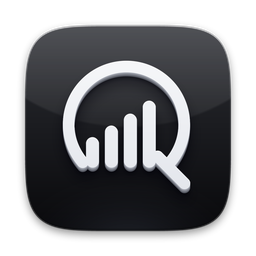
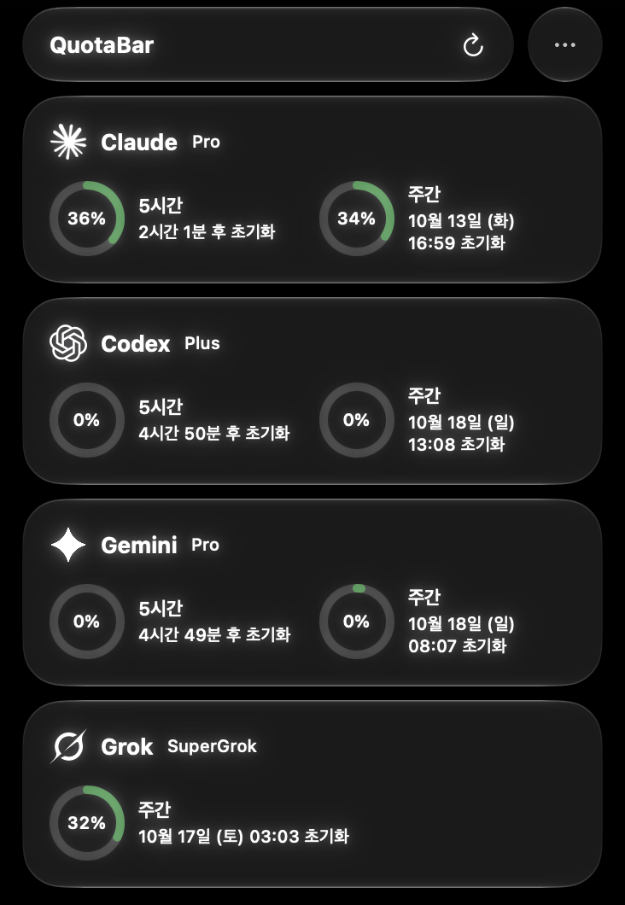
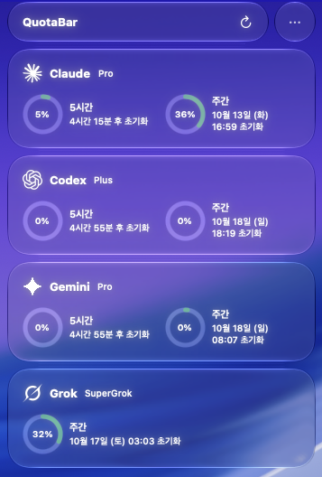
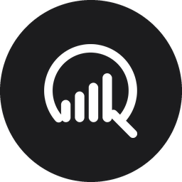
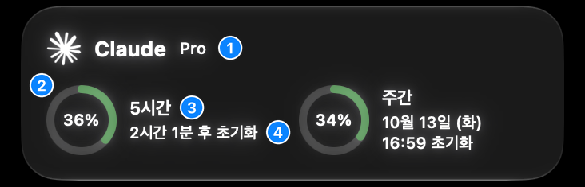
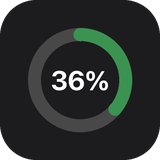
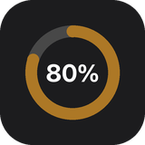
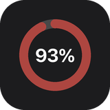
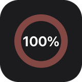
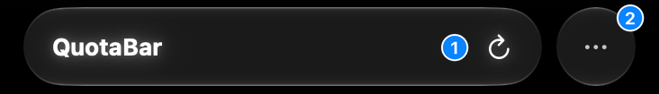

<div align="center">



# QuotaBar

### 한도에 걸리기 전에, 미리 보세요.

Claude · Codex · Gemini · Grok 의 남은 사용량을<br>메뉴바 클릭 한 번으로 확인하는 macOS 앱


[**설치**](#설치) · [**사용법**](#사용법) · [**설정**](#설정) · [**자주 묻는 질문**](#자주-묻는-질문) · [**개인정보**](#개인정보)

<p>

&nbsp;&nbsp;

</p>

</div>

## 왜 QuotaBar 인가요

한창 일하는 중에 **한도를 다 썼다는 안내**를 만나 본 적이 있나요?

AI 구독에는 5시간·일주일 단위의 사용 한도가 있는데, 얼마나 남았는지는 서비스마다 프로그램을 열어 따로 물어봐야 합니다. 그래서 대부분 확인하지 않고 쓰다가 막힙니다. QuotaBar 는 그 확인을 클릭 한 번으로 줄입니다.

- **네 서비스를 한 화면에** — Claude, Codex, Gemini, Grok 의 사용량이 한꺼번에 보입니다. 지금 어느 쪽에 여유가 있는지 바로 알 수 있습니다.
- **언제 풀리는지까지** — 몇 % 썼는지와 함께, 다시 0% 로 돌아가는 시각을 알려 줍니다.
- **로그인할 것이 없음** — 아이디·비밀번호를 입력하지 않습니다. 이 Mac 에서 이미 로그인해 둔 계정을 그대로 씁니다.
- **알아서 최신으로** — 10분마다 새 값을 받아 옵니다.
- **아무것도 내보내지 않음** — 각 서비스의 공식 서버 말고는 어디에도 연결하지 않습니다.

## 설치

**필요한 것** — macOS 14 (Sonoma) 이상인 Mac, 그리고 네 서비스 중 하나 이상의 유료 구독

1. `QuotaBar-0.1.0.dmg` 를 열고 QuotaBar 를 **Applications** 폴더로 끌어다 놓습니다.
2. 응용 프로그램 폴더에서 QuotaBar 를 엽니다.
3. 화면 맨 위 오른쪽에 생긴 아이콘을 누릅니다.

DMG 파일이 없다면 [소스에서 직접 빌드](#개발)할 수 있습니다.

<details>
<summary><b>"확인되지 않은 개발자" 또는 "손상되었습니다" 라는 창이 뜬다면</b></summary>

<br>

앱이 고장 난 것이 아닙니다. Apple 에 등록하지 않은 앱을 처음 열 때 Mac 이 한 번 막는 것입니다. 아래 둘 중 하나를 한 번만 하면 됩니다.

- **시스템 설정 → 개인정보 보호 및 보안** 을 열고 아래쪽의 **그래도 열기** 를 누릅니다.
- 또는 터미널에 아래 한 줄을 붙여 넣고 Enter 를 누른 뒤 앱을 다시 엽니다.
  ```bash
  xattr -dr com.apple.quarantine /Applications/QuotaBar.app
  ```

</details>

### 계정 연결

따로 연결하는 절차는 없습니다. 각 서비스의 터미널용 프로그램에 로그인되어 있으면 QuotaBar 가 그 계정을 읽어 옵니다. **평소에 이미 쓰고 있다면 할 일이 없습니다.**

| 서비스 | 필요한 요금제 | 터미널에 입력 |
| --- | --- | --- |
| Claude | Pro 또는 Max | `claude` |
| Codex | ChatGPT Plus, Pro 등 | `codex login` |
| Gemini | Google AI Pro 또는 Ultra | `agy` |
| Grok | SuperGrok | `grok login` |

프로그램이 아직 없어도 괜찮습니다. QuotaBar 의 해당 칸에 **로그인** 또는 **설치하고 로그인** 버튼이 생기고, 누르면 터미널이 열려 나머지를 진행해 줍니다.

> **Gemini 를 회사·학교 계정으로 쓴다면** `agy` 대신 `gemini` 로 로그인하고, 설정의 **가져오는 곳** 을 **Gemini CLI** 로 바꾸세요.

## 사용법

### 열기

QuotaBar 는 창이 없는 앱입니다. 켜면 **화면 맨 위 오른쪽**에 아이콘이 생기고, 그 아이콘을 누르면 사용량 화면이 열립니다. Dock 에는 나타나지 않습니다.

|  |  |
| :---: | :---: |
| **화면 맨 위(메뉴 막대)의 아이콘**<br>누르면 사용량 화면이 열립니다 | **응용 프로그램 폴더의 아이콘**<br>앱을 켤 때 두 번 누릅니다 |

처음 열 때 Mac 이 **"키체인에 접근하려고 합니다"** 라고 물으면 **항상 허용** 을 누르세요. 로그인해 둔 계정을 읽기 위한 것이고, 한 번 허용하면 다시 묻지 않습니다.

### 화면 읽기



| 번호 | 무엇인가요 |
| :---: | --- |
| **1** | 내가 가입한 요금제 이름 (Pro, Plus, SuperGrok 등) |
| **2** | 한도 중에서 **이미 쓴 양**. 36% 면 36 을 썼고 64 가 남았다는 뜻입니다 |
| **3** | 한도가 적용되는 기간. **5시간** 한도와 **주간**(7일) 한도가 따로 있습니다 |
| **4** | 다시 0% 로 돌아가는 때. "2시간 1분 후" 또는 "10월 13일 (화) 16:59" 처럼 나옵니다 |

위 그림은 이렇게 읽습니다 — Claude **Pro** 요금제이고, 5시간 한도는 **36%** 를 써서 **2시간 1분 뒤**에 풀리며, 주간 한도는 **34%** 를 써서 **10월 13일 화요일 16:59** 에 풀립니다.

서비스에 따라 칸의 모양이 조금 다릅니다. 예를 들어 Grok 은 주간 한도 하나만 있어서 동그라미가 하나입니다.

### 동그라미 색

많이 쓸수록 초록 → 주황 → 빨강으로 바뀝니다.

| | 쓴 양 | 뜻 |
| :---: | :---: | --- |
|  | 75% 미만 | 여유 있음 |
|  | 75% 이상 | 많이 썼음 |
|  | 90% 이상 | 거의 다 썼음 |
|  | 100% | 다 썼음. 풀리는 때까지 기다려야 합니다 |

동그라미가 **회색**이면 새 값을 받아 오지 못해 예전 값을 보여 주는 중입니다. 이유와 해결 방법이 그 칸 아래에 함께 적힙니다.

### 버튼과 단축키



| 번호 | 누르면 |
| :---: | --- |
| **1** | **QuotaBar** 라고 적힌 긴 칸 어디든 누르면 지금 바로 새 값을 받아 옵니다 |
| **2** | **⋯** 를 누르면 메뉴가 열립니다 — 설정, 로그인 시 자동 실행, QuotaBar 종료 |

| 하고 싶은 것 | 방법 | 단축키 |
| --- | --- | :---: |
| 지금 새로고침 | **QuotaBar** 칸 누르기 | `⌘R` |
| 설정 열기 | **⋯** → **설정…** | `⌘,` |
| 화면 닫기 | 아이콘을 한 번 더 누르거나 다른 곳 누르기 | |
| 쓰지 않는 서비스 감추기 | 그 칸의 **숨기기** | |
| Mac 을 켤 때마다 자동으로 켜기 | **⋯** → **로그인 시 자동 실행** | |
| 앱 끄기 | **⋯** → **QuotaBar 종료** | `⌘Q` |

## 설정

**⋯** → **설정…** (`⌘,`) 을 누르면 설정 창이 열립니다. 바꾸지 않아도 잘 동작합니다.

| 설정 창의 항목 | 하는 일 |
| --- | --- |
| 표시할 서비스 | 네 서비스 중 보고 싶은 것만 켭니다. 숨긴 칸도 여기서 다시 켭니다 |
| 자동 새로고침 간격 | 몇 분마다 새 값을 받아 올지 정합니다. 처음 값은 10분입니다 |
| Gemini → 가져오는 곳 | 개인 계정이면 **자동** 그대로, 회사·학교 계정이면 **Gemini CLI** |
| Gemini → Claude·GPT 모델 한도도 표시 | Antigravity 안에서 Claude·GPT 를 쓸 때의 한도도 Gemini 칸에 함께 보여 줍니다 |
| 로그인 시 자동 실행 | Mac 을 켜면 QuotaBar 도 같이 켜집니다 |
| 글자 또렷하게 | 글자가 뒤 배경에 묻혀 안 보일 때 켭니다 |
| CLI 실행 파일 · CLI 설정 폴더 | 비워 두세요. "찾을 수 없습니다" 라고 나올 때만 씁니다 |

> 새로고침 간격을 너무 짧게 하면 서비스 쪽에서 잠시 값을 주지 않을 수 있습니다. 10분을 권합니다.

## 자주 묻는 질문

<details>
<summary><b>앱을 열었는데 아무것도 안 보여요</b></summary>

<br>

정상입니다. QuotaBar 는 창이 없습니다. 화면 맨 위 오른쪽의 아이콘을 찾아 누르세요.

</details>

<details>
<summary><b>앱이 아예 열리지 않아요</b></summary>

<br>

[설치](#설치)의 "확인되지 않은 개발자" 안내를 따라 하세요. 처음 한 번만 필요합니다.

</details>

<details>
<summary><b>칸에 숫자 대신 글이 나와요</b></summary>

<br>

| 칸에 나오는 글 | 이렇게 하세요 |
| --- | --- |
| 로그인 정보를 찾을 수 없습니다 | 그 칸의 **로그인** 버튼을 누릅니다 |
| CLI 를 찾을 수 없습니다 | 그 칸의 **설치하고 로그인** 버튼을 누릅니다 |
| 로그인이 만료되었습니다 | 터미널에서 그 서비스의 프로그램을 한 번 켰다 끕니다 (예: `claude`). 그다음 QuotaBar 를 새로고침합니다 |
| 사용량 조회가 잠시 제한됐습니다 | 기다리면 됩니다. 적혀 있는 시각이 지나면 알아서 다시 받아 옵니다. 내 사용 한도가 줄어든 것은 아닙니다 |
| 응답 형식을 해석하지 못했습니다 | 서비스 쪽이 바뀌어 지금 버전으로는 읽지 못하는 상태입니다. 새 버전의 QuotaBar 가 필요합니다 |

</details>

<details>
<summary><b>숫자가 예전 값 그대로예요</b></summary>

<br>

**QuotaBar** 칸을 누르거나 `⌘R` 로 새로고침하세요. 동그라미가 회색이면 그 칸 아래에 적힌 이유를 확인하세요.

</details>

<details>
<summary><b>숨긴 서비스를 다시 보고 싶어요</b></summary>

<br>

**⋯** → **설정…** → **표시할 서비스** 에서 다시 켭니다.

</details>

<details>
<summary><b>한도를 늘려 주거나, 지난 사용 기록을 보여 주나요?</b></summary>

<br>

아니요. QuotaBar 는 지금 값을 보여 주기만 합니다. 지난 기록이나 요금 그래프는 없고, 쓴 만큼 돈을 내는 방식(API 요금)의 사용량도 아직 다루지 않습니다.

</details>

## 개인정보

- QuotaBar 는 이 Mac 에 저장된 로그인 정보를 **읽기만** 합니다. 고치거나 지우지 않습니다.
- 읽은 정보는 그 서비스의 회사(Anthropic · OpenAI · Google · xAI)에 "내 사용량이 얼마냐" 고 물을 때만 씁니다.
- 그 네 곳 말고는 어디에도 연결하지 않습니다. 만든 사람에게도, 다른 서버에도 아무것도 보내지 않습니다.
- 사용 기록을 모으지 않고, 광고도 없습니다.

**알아 둘 점**

- 사용량을 받아 오는 방법은 각 회사가 공식적으로 안내한 것이 아닙니다. 회사 쪽이 방식을 바꾸면 한동안 값이 안 나올 수 있습니다.
- 내 계정의 사용량을 보는 용도로만 쓰세요.

## 개발

<details>
<summary><b>직접 빌드하기, 터미널 도구, 설정 파일, 문서</b></summary>

<br>

### 소스에서 빌드

Xcode 16 이상이 필요합니다. 뒤가 비치는 유리 모양은 Xcode 26 이상으로 빌드하고 macOS 26 이상에서 실행할 때 보이며, 그 밖에는 기본 모양으로 보입니다.

```bash
cd QuotaBar
./scripts/build-app.sh --install    # 빌드 → /Applications/QuotaBar.app 설치 → 실행
./scripts/build-dmg.sh              # 나눠 줄 수 있는 build/QuotaBar-<버전>.dmg 만들기
swift build                         # 앱 + 터미널 도구 + Core
swift test                          # 테스트
open Package.swift                  # Xcode 에서 열기 → 스킴 QuotaBar 실행
```

`UNIVERSAL=1` 을 앞에 붙이면 Intel Mac 에서도 실행되는 앱을 만듭니다.

### 터미널 도구 `quotabar-cli`

앱과 같은 코드로 사용량을 받아 옵니다. 값이 안 나오는 이유를 볼 때 씁니다.

```bash
swift run quotabar-cli                 # 켜진 서비스 전부
swift run quotabar-cli claude codex    # 일부만
swift run quotabar-cli --json gemini   # 서비스가 준 값을 JSON 으로
swift run quotabar-cli config          # 설정 파일 위치, 찾은 프로그램 경로
swift run quotabar-cli init            # 설정 파일 새로 만들기
```

### 설정 파일 `~/.config/quotabar/.env`

설정 창의 값이 이 파일에 저장됩니다. 직접 고친 뒤에는 **⋯** → **설정 다시 불러오기**. 전체 항목은 [.env.example](.env.example).

| 키 | 처음 값 | 설명 |
| --- | --- | --- |
| `QUOTABAR_REFRESH_MINUTES` | `10` | 새로고침 간격(분), 최소 1 |
| `QUOTABAR_<서비스>_ENABLED` | `true` | `CLAUDE`, `CODEX`, `GEMINI`, `GROK` 켜기/끄기 |
| `QUOTABAR_GEMINI_SOURCE` | `auto` | `auto` / `antigravity` / `gemini-cli` |
| `QUOTABAR_GEMINI_PLAN` | 자동 | Gemini 칸에 표시할 요금제 이름 |
| `QUOTABAR_GEMINI_THIRD_PARTY` | `false` | Antigravity 의 Claude·GPT 모델 한도도 표시 |
| `*_CLI_PATH` | 자동으로 찾음 | `CLAUDE_CLI_PATH`, `CODEX_CLI_PATH`, `ANTIGRAVITY_CLI_PATH`, `GEMINI_CLI_PATH`, `GROK_CLI_PATH` |
| `CLAUDE_CONFIG_DIR`, `CODEX_HOME`, `GROK_HOME` | 기본 위치 | 각 프로그램의 설정 폴더가 다른 곳에 있을 때 |

- 다른 위치의 설정 파일: 환경 변수 `QUOTABAR_ENV_FILE=/path/to/.env`
- 셸에서 export 한 값이 파일의 값보다 먼저 적용됩니다.
- `.env.example` 을 고치면 `./scripts/sync-env-template.sh` 를 실행하세요.

### 문서

| 문서 | 내용 |
| --- | --- |
| [DESIGN.md](https://github.com/jheroorehj/design-systems/blob/main/swiftui-liquid-glass/DESIGN.md) | 화면 디자인 규칙 (별도 저장소 `design-systems`) |

</details>

## 참고

사용량을 받아 오는 방법은 오픈소스 [CodexBar](https://github.com/steipete/CodexBar)(MIT)를 참고했습니다.
